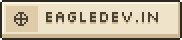
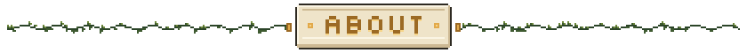
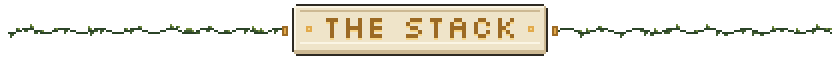
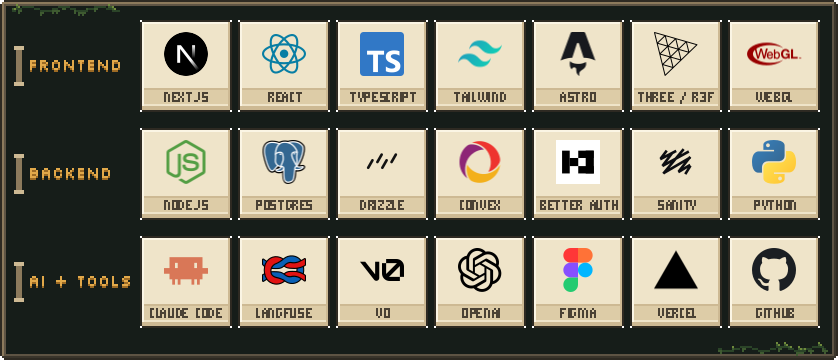
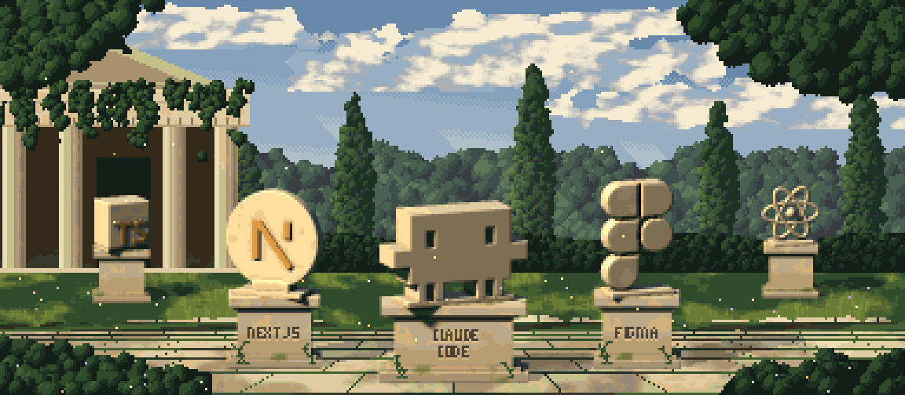
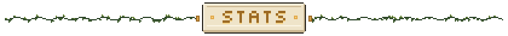
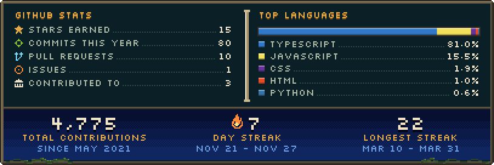

  

  
  
  

  
  
  

Hi, I'm **Vighnesh**, though most people call me **Eagle**. I'm a product designer and yeah with great fullstack dev experience too.

I build products end to end, mostly SaaS and enterprise tools. I also keep a corner of my work for creative coding with WebGL, GLSL and React Three.

<!-- Building section hidden for now: remove these comment markers to show it again

- **[Solithix Studios](https://solithix.com)**: design and engineering partner for founders
- **[Mission Control](https://eagledev.in/blog/why-i-built-mission-control)**: my open-source multi-agent research tool
- **[Fathom](https://github.com/EAGLE1309/fathom-search-engine)**: a search engine built from scratch, with an AI agent interface
- **[Always Reflection](https://always-reflection.vercel.app)**: a Minecraft Bedrock shader pack with reflective water and reworked lighting
- **ReWater**: a water treatment monitoring platform that won Smart India Hackathon 2025
-->

  

  

<!-- BLOG-POST-LIST:START -->
<!-- BLOG-POST-LIST:END -->

➜ More on **[dev.to/eagle1309](https://dev.to/eagle1309)** and **[eagledev.in](https://eagledev.in)**

  

  

